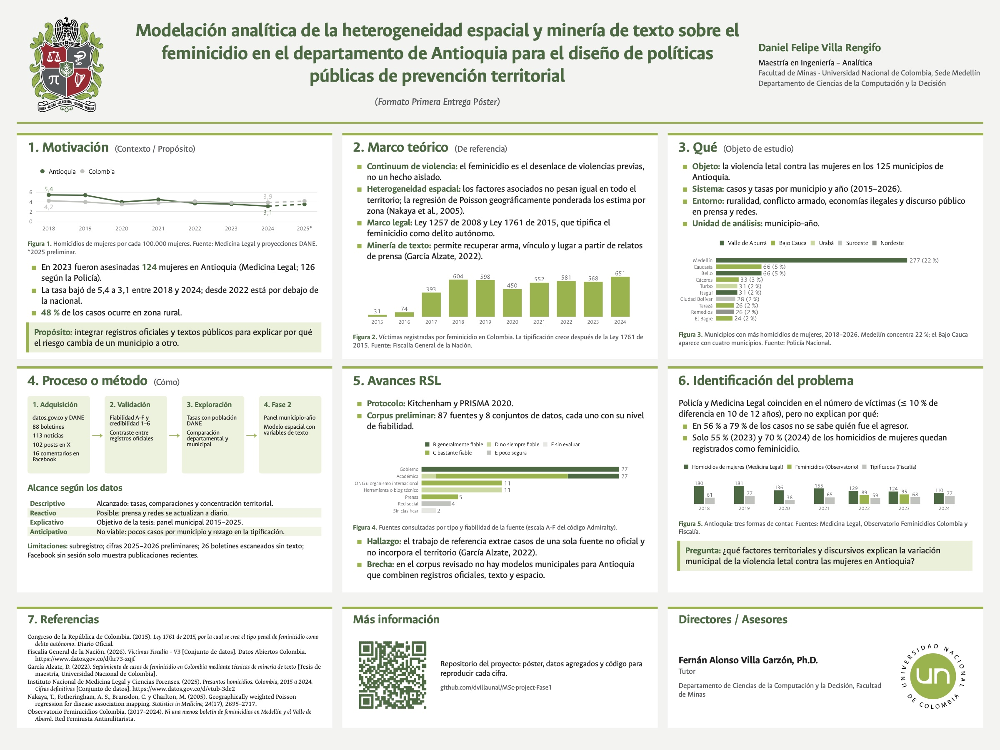

# Feminicidio en Antioquia: heterogeneidad espacial y minería de texto

**Modelación analítica de la heterogeneidad espacial y minería de texto sobre el feminicidio en el departamento de Antioquia para el diseño de políticas públicas de prevención territorial**

Trabajo de grado de la Maestría en Ingeniería – Analítica, Facultad de Minas, Universidad Nacional de Colombia, Sede Medellín.

- **Estudiante:** Daniel Felipe Villa Rengifo
- **Tutor:** Fernán Alonso Villa Garzón, Ph.D. (Departamento de Ciencias de la Computación y la Decisión)
- **Estado:** Fase 1, exploratoria. El repositorio se irá ampliando con cada fase.

[](04_Entregables/Poster_Fase1/Poster_Fase1.pdf)

Póster en PDF (120 × 90 cm): [`04_Entregables/Poster_Fase1/Poster_Fase1.pdf`](04_Entregables/Poster_Fase1/Poster_Fase1.pdf)

## Pregunta de investigación

¿Qué factores territoriales y discursivos explican la variación municipal de la violencia letal contra las mujeres en Antioquia?

## Qué se hizo en la Fase 1

1. **Adquisición.** Consultas agregadas a las APIs de datos.gov.co (Fiscalía, Policía Nacional y Medicina Legal), proyecciones de población del DANE, 88 boletines del Observatorio Feminicidios Colombia, 113 noticias sobre Antioquia, 102 publicaciones en X y 16 comentarios en Facebook.
2. **Validación.** Cada fuente se califica con el código Admiralty: una letra para la fiabilidad de la fuente (A a F) y un número para la credibilidad del dato (1 a 6). Las cifras se contrastan entre registros antes de usarlas.
3. **Exploración.** Tasas por 100.000 mujeres, comparación de Antioquia con el resto del país y concentración por municipio.

## Lo que muestran los datos

| Resultado | Fuente |
| :-- | :-- |
| En 2023 fueron asesinadas 124 mujeres en Antioquia (126 según la Policía). | Medicina Legal; Policía Nacional |
| La tasa bajó de 5,4 a 3,1 por 100.000 mujeres entre 2018 y 2024. Desde 2022 está por debajo de la nacional (2024: 3,1 frente a 3,9). | Medicina Legal; DANE |
| El 48 % de los casos ocurre en zona rural (2019–2025). | Policía Nacional |
| Medellín concentra el 22 % de los casos desde 2018. Cuatro de los diez municipios con más casos son del Bajo Cauca. | Policía Nacional |
| Policía y Medicina Legal difieren en 10 % o menos en 10 de 12 años. | Policía Nacional; Medicina Legal |
| Solo el 55 % (2023) y el 70 % (2024) de los homicidios de mujeres quedan registrados como feminicidio. | Fiscalía; Medicina Legal |
| En 56 % a 79 % de los casos, según el año, no se sabe quién fue el agresor. | Medicina Legal |

Los registros oficiales coinciden en cuántas mujeres son asesinadas, pero no explican por qué ni por qué el riesgo cambia de un municipio a otro. Ese es el problema que aborda la tesis.

## Alcance según los datos

| Enfoque | Estado |
| :-- | :-- |
| Descriptivo | Alcanzado: tasas, comparaciones y concentración territorial. |
| Reactivo | Posible: prensa y redes se actualizan a diario. |
| Explicativo | Objetivo de la tesis: panel municipal 2015–2025. |
| Anticipativo | No viable: pocos casos por municipio y rezago en la tipificación. |

**Limitaciones.** Hay subregistro. Las cifras de 2025 y 2026 son preliminares. 26 boletines del Observatorio son escaneados y todavía no tienen texto extraído. Facebook sin sesión solo muestra publicaciones recientes.

## Datos

Todos los archivos de [`03_Fuentes_y_Datos/datos/procesados/`](03_Fuentes_y_Datos/datos/procesados/) son agregados por departamento, municipio o año. No contienen datos de personas.

| Conjunto | Origen | Clasificación |
| :-- | :-- | :-: |
| Víctimas Fiscalía V3 (feminicidio) | [datos.gov.co `hr73-zqjf`](https://www.datos.gov.co/d/hr73-zqjf) | B3 |
| Homicidios (Policía Nacional) | [datos.gov.co `m8fd-ahd9`](https://www.datos.gov.co/d/m8fd-ahd9) | B2 |
| Presuntos homicidios 2015–2024 (Medicina Legal) | [datos.gov.co `vtub-3de2`](https://www.datos.gov.co/d/vtub-3de2) | B2 |
| Lesiones fatales 2025–2026, preliminar (Medicina Legal) | [datos.gov.co `2kpj-cktv`](https://www.datos.gov.co/d/2kpj-cktv) | B4 |
| Proyecciones de población 2018–2050 (DANE) | [dane.gov.co](https://www.dane.gov.co/files/censo2018/proyecciones-de-poblacion/Departamental/PPED-AreaSexoEdadDep-2018-2050_VP.xlsx) | A2 |
| Boletines «Ni una menos» (Observatorio Feminicidios Colombia) | [observatoriofeminicidioscolombia.org](https://observatoriofeminicidioscolombia.org/) | C6 |

La base de víctimas de la Fiscalía tiene cerca de 17,6 millones de registros. En esta fase no se descarga completa: se piden a la API solo los conteos agregados. La misma consulta puede ampliarse a más variables o a nivel municipal cuando el modelo lo necesite.

De prensa y redes sociales solo se publica el número de piezas reunidas ([`conteos_redes_noticias.csv`](03_Fuentes_y_Datos/datos/procesados/conteos_redes_noticias.csv)), no los textos.

### Clasificación de las fuentes

[`validacion_fuentes.json`](03_Fuentes_y_Datos/datos/validacion_fuentes.json) lista las fuentes consultadas con su código Admiralty.

- **Letra (fiabilidad de la fuente):**
  - A: fiable.
  - B: generalmente fiable (entidades oficiales, artículos revisados por pares).
  - C: bastante fiable (prensa, ONG).
  - D: no siempre fiable.
  - E: poco segura (redes sociales).
  - F: fiabilidad no evaluable.
- **Número (credibilidad del dato):**
  - 1: confirmado.
  - 2: probable (por ejemplo, dos registros independientes coinciden).
  - 3: posible.
  - 4: dudoso.
  - 5: improbable.
  - 6: exactitud no evaluable.

Lo que no se ha evaluado queda como F6.

## Cómo reproducir el póster

Requisitos:
- [Quarto](https://quarto.org/) 1.9 o superior (incluye Typst).
- R 4.x con `dplyr`, `readr`, `tidyr`, `jsonlite`, `stringr`, `ggplot2`, `svglite`, `forcats` y `qrcode`.
- Fuentes Ancízar Sans y Ancízar Serif, de la identidad visual de la UNAL. Sin ellas, el póster usa Helvetica Neue.

```r
install.packages(c("dplyr", "readr", "tidyr", "jsonlite", "stringr", "ggplot2", "svglite", "forcats", "qrcode"))
```

```bash
cd 04_Entregables/Poster_Fase1
quarto render Poster_Fase1.qmd --to poster-unal-typst
```

Ninguna cifra del póster está escrita a mano:
- [`R/datos_poster.R`](04_Entregables/Poster_Fase1/R/datos_poster.R) calcula todas las cifras a partir de los CSV.
- [`R/figuras_poster.R`](04_Entregables/Poster_Fase1/R/figuras_poster.R) dibuja las figuras en SVG, al tamaño en que se imprimen.

## Cómo volver a descargar los datos oficiales

```bash
python -m venv .venv
.venv/bin/python -m pip install -r requirements.txt
.venv/bin/python scripts/extraer_datos_oficiales.py
```

El script consulta las APIs de datos.gov.co y descarga una vez el archivo de población del DANE. Funciona sin clave, pero con una clave de datos.gov.co las consultas son más estables; se pone en un archivo `.env` (ver [`.env.example`](.env.example)).

## Estructura

```
03_Fuentes_y_Datos/datos/procesados/   CSV agregados que usa el póster
03_Fuentes_y_Datos/datos/              registro de fuentes clasificadas (JSON)
04_Entregables/Poster_Fase1/           póster: Quarto, R, formato Typst, logos y PDF
scripts/                               descarga de datos oficiales (Python)
```

## Próximas fases

- **Fase 2.** Panel municipio–año 2015–2025. Extracción de variables de texto de prensa, boletines y redes: arma, vínculo con el agresor y lugar. Modelo espacial (regresión de Poisson geográficamente ponderada) para estimar cómo cambia el peso de cada factor según el territorio.

## Licencia

- **Código** (R, Python y formato Typst): [MIT](LICENSE).
- **Póster, figuras y textos:** [CC BY 4.0](https://creativecommons.org/licenses/by/4.0/deed.es). Se pueden reutilizar citando al autor.
- **Datos:** son agregados derivados de fuentes públicas y conservan los términos de uso de cada entidad. Al reutilizarlos, cita la fuente original (tabla de la sección Datos).
- **Escudo y logotipo de la Universidad Nacional de Colombia:** son marcas de la Universidad y no quedan cubiertos por estas licencias.

## Créditos

- Formato del póster adaptado de [quarto-ext/typst-templates](https://github.com/quarto-ext/typst-templates/tree/main/poster). Esa plantilla se basa en typst-poster (MIT, © 2023 Parth Parikh).
- Escudo y logotipo de la Universidad Nacional de Colombia tomados de [Wikimedia Commons](https://commons.wikimedia.org/wiki/File:Escudo_de_la_Universidad_Nacional_de_Colombia_(2016).svg), según la [identidad visual UNAL](https://identidad.unal.edu.co/).
- Datos: Fiscalía General de la Nación, Policía Nacional, Instituto Nacional de Medicina Legal y Ciencias Forenses, DANE y Observatorio Feminicidios Colombia.
